# LevelUp+

**Run more, level up, and take over your neighbourhood.**

LevelUp+ is a running app for Singapore with game mechanics. Every km earns XP, XP unlocks levels, titles and badges, and every street you run claims hex tiles on a shared map. Run the most km in a town and you're its King, until someone takes it back.

<p align="center">
  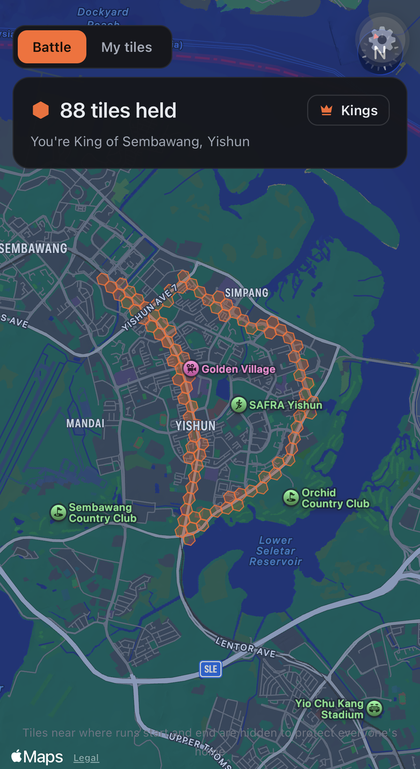
  &nbsp;&nbsp;
  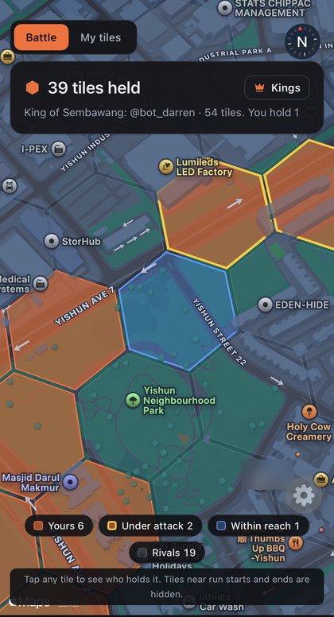
</p>

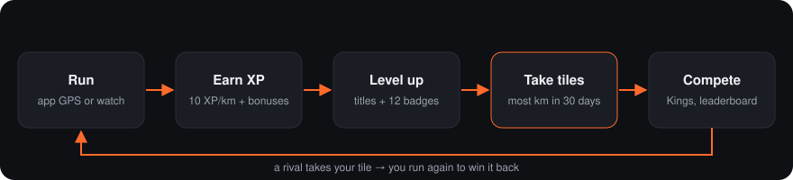

---

## Contents

- [Features](#features)
- [First run](#first-run)
- [How the game works](#how-the-game-works)
- [Area Battle: how tiles work](#area-battle-how-tiles-work)
- [Where runs come from](#where-runs-come-from)
- [Privacy](#privacy)
- [How it's built](#how-its-built)
- [Run it yourself](#run-it-yourself)
- [Testing with bots](#testing-with-bots)
- [Project structure](#project-structure)
- [Roadmap](#roadmap)

---

## Features

| Tab | What it does |
|---|---|
| **Run** | Live GPS tracking: distance, time, pace and your route. Pause and resume. In the app build it keeps tracking with the screen locked. Shows progress toward your weekly km goal. |
| **Territory** | **Battle**: the shared map of who holds every tile, with steal alerts and a Kings list per town. **My tiles**: every tile you've run in during the last 30 days. |
| **Community** | Add friends by username, see a friends-only feed of runs, level-ups and badges with kudos, and a weekly XP leaderboard (Friends / My town / All Singapore, resets Monday). |
| **Progress** | Level, title, XP bar, and badges that show how close you are to the ones you haven't earned. Run history (long-press a run to delete it; everything is recalculated). |
| **Profile** | Username, avatar, home town and weekly goal. Tile alerts, Apple Health and Strava connections, and your account (including forgot-password). |

---

## First run

New runners get a three-screen intro, then pick the home town they'll defend. Others only ever see a username; routes stay private.

<p align="center">
  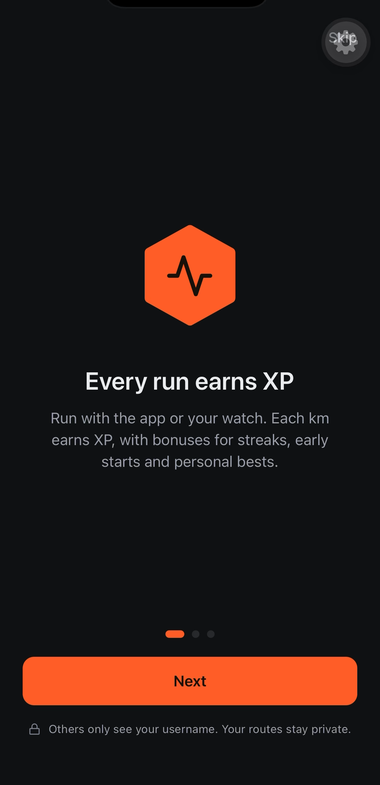
  &nbsp;
  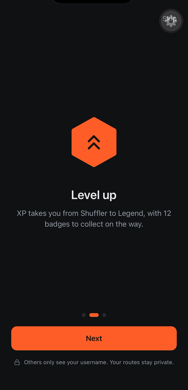
  &nbsp;
  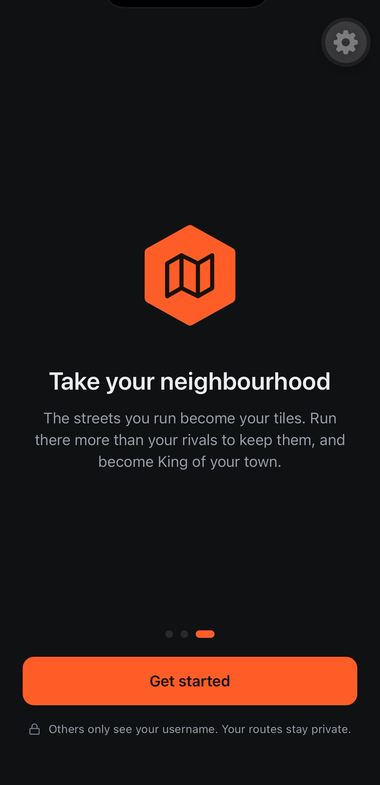
</p>

---

## How the game works

### XP

| Action | XP |
|---|---|
| Every km | **10 XP**, halved after 60 km in a week |
| Streak | +10% per day in a row, up to +50% |
| Run started before 8am | +20% |
| Longest-run personal best (3 km+, by 0.5 km or more, once a week) | +100 |
| Fastest-pace personal best (3 km+, by 5 sec/km or more, once a week) | +100 |
| A tile you've never run in before | +5 each |
| A new badge | +50 |

**Anti-cheat:** GPS jumps are filtered out, and a run that averages faster than 2:30/km earns nothing. Runs tracked by the phone's GPS (not a watch) have a stricter limit of 3:20/km over 2 km or more, to keep out bike rides.

### Levels and titles

Total XP for level L = 25 × (L − 1)^1.8, so early levels come quickly and later ones take real commitment.

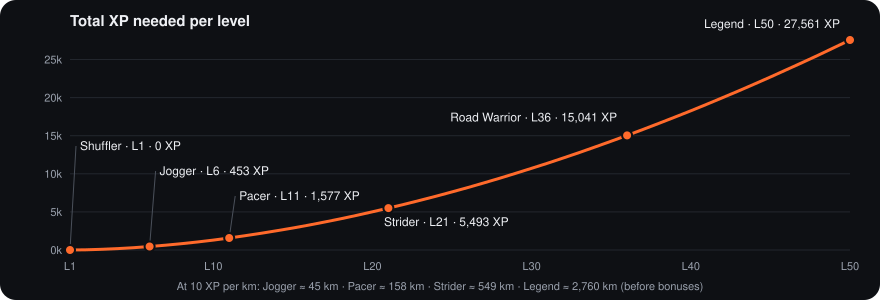

| Title | From level |
|---|---|
| Shuffler | 1 |
| Jogger | 6 |
| Pacer | 11 |
| Strider | 21 |
| Road Warrior | 36 |
| Legend | 50 |

### Badges

First Steps · 5K Club · Double Digits (10K) · Half Marathoner · On Fire (3-day streak) · Unstoppable (7-day streak) · Sunrise Runner · 50 km Total · Century (100 km) · Land Grabber (10 tiles) · Explorer (50 different tiles) · Town Hopper (tiles in 3 towns)

**Streak freezes:** you earn one for every 7-day streak (hold up to 2). A freeze saves your streak if you miss a day.

---

## Area Battle: how tiles work

Singapore is covered in hexagons about **156 m across**. Your GPS route is cut into pieces of 40 m or less, and each piece's distance goes to the tile it falls in. One pass through a tile adds about **0.1–0.18 km**. Running out and back on the same street counts twice.

- A tile belongs to **whoever ran the most km in it over the last 30 days**. Old runs drop off by themselves, so you have to keep defending your turf.
- To take a tile you need just over the owner's km. Tap any tile to see the exact gap.
- Whoever holds the most tiles in a town is its **King**.
- When a rival is close to taking your tiles, or takes them, you get a push notification (at most a few a day). The lost tiles also show in red the next time you open the map.

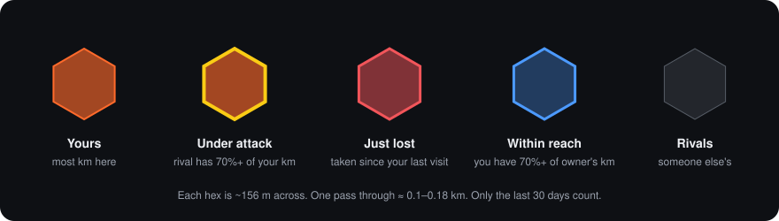

---

## Where runs come from

| Source | XP and badges | Battle map, leaderboard, feed |
|---|---|---|
| Runs recorded in the app | ✅ | ✅ |
| **Apple Health** (Apple Watch, Garmin, Coros and more) | ✅ | ✅ after the runner agrees |
| **Strava** | ✅ | ❌ personal only, because of Strava's API rules |

Apple Health imports 90 days of runs when you connect, then syncs the last 14 days each time you open the app. Workouts written by Strava are skipped, and a run that appears in more than one source only counts once. If a run comes in from both Strava and Apple Health, the Apple Health copy replaces the Strava one so it can count publicly.

A run recorded in the app shows its reward screen the moment you finish. A watch run arrives in the background, so when it syncs LevelUp+ shows a **"While you were away"** summary instead: the XP earned, any level-up, and what it did on the Battle map.

<p align="center">
  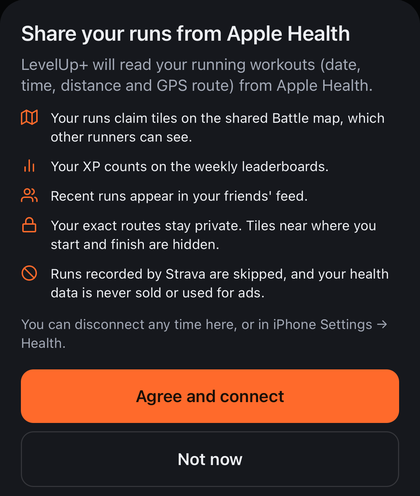
  &nbsp;&nbsp;
  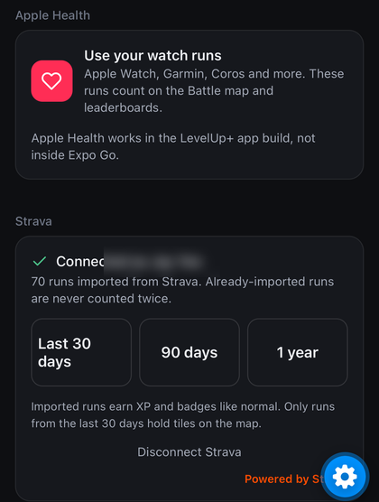
</p>

<p align="center">
  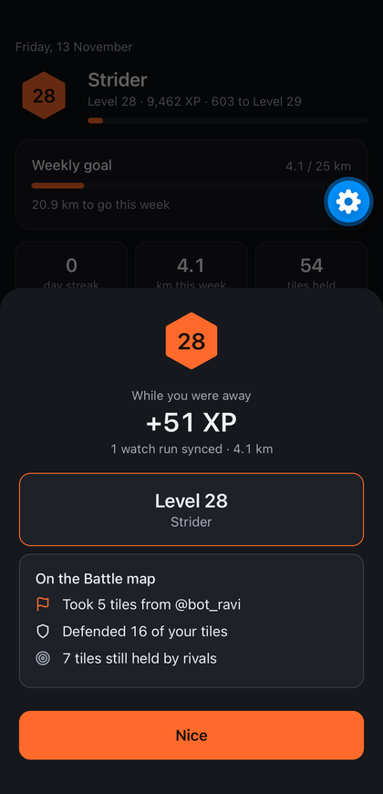
</p>

---

## Privacy

- **Usernames only.** You log in with your email or username, but other runners only ever see your username. Username login runs on the server, so emails never reach anyone's phone.
- **Routes stay private.** The shared map only shows who holds each tile and their km totals, never anyone's route.
- **Homes are protected.** Tiles within about 300 m of where each run starts and ends never count and are never shown.
- **The feed is friends-only.** The Battle map is visible to everyone who's logged in.
- **Health data** is never sold or used for ads (Apple guideline 5.1.3).
- **Strava data** is only ever shown to the runner it belongs to.

---

## How it's built

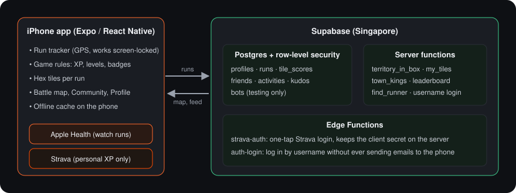

- **App:** React Native with Expo SDK 58 and Expo Router, written in TypeScript. Maps use react-native-maps, and Apple Health uses `@kingstinct/react-native-healthkit`.
- **Backend:** Supabase in Singapore. Postgres with row-level security holds the data, and SQL functions compute the map, Kings and leaderboards. Two Edge Functions handle Strava login and username login.
- **Game rules** run on the phone (`src/lib/game.ts`). The server keeps the per-tile km scores. Server-side XP is planned before a public launch.

---

## Run it yourself

You need a Mac (or PC), an iPhone, and Node.js LTS from https://nodejs.org.

```bash
git clone https://github.com/Jayyeosq/levelup-.git levelup-plus
cd levelup-plus
npm install
```

**On the LevelUp+ app build** (needs an Apple Developer account; supports Apple Health and screen-locked tracking):

```bash
npx eas-cli@latest build --profile development --platform ios   # once, or after native changes
npx expo start --dev-client --tunnel ngrok
```

**In Expo Go** (no Apple Health, keep the screen on while running):

```bash
npx expo start --go --tunnel ngrok -c
```

Scan the QR code with the iPhone camera. Tunnel mode works on any Wi-Fi as long as the computer stays awake (run `caffeinate -d` in a second Terminal window on a Mac).

### One-time backend setup

1. Create a Supabase project and put its URL and publishable key in `app.json` → `extra`. See **[ACCOUNTS_SETUP.md](ACCOUNTS_SETUP.md)**.
2. In the Supabase SQL Editor, run the files in `supabase/migrations/` in order (`0001` to `0007`), then run `notify pgrst, 'reload schema';`.
3. Optional: Strava login, see **[STRAVA_SETUP.md](STRAVA_SETUP.md)**. Apple Health, see **[HEALTH_SETUP.md](HEALTH_SETUP.md)**.

To change the game balance, edit the numbers at the top of `src/lib/game.ts`.

---

## Testing with bots

To see how the app feels with rivals before inviting real testers, you can add fake runners that run routes and steal tiles. Run these in the Supabase SQL Editor (full guide: **[BOTS_SETUP.md](BOTS_SETUP.md)**):

```sql
select public.seed_bots(6, 'Yishun');      -- 6 bots running around Yishun
select public.bot_raid('your_username', 2); -- a bot steals 2 of your tiles
select public.bots_tick();                  -- bots go for runs (can be scheduled hourly)
select public.delete_bots();                -- remove every bot before real testers join
```

Bots have `bot_` usernames, real users can't sign up with that prefix, and only the SQL Editor can control them.

---

## Project structure

```
index.ts                    starts the background GPS task, then the app
app.json                    app name, permissions, Supabase settings
eas.json                    app build profiles
src/app/                    screens (one file = one tab)
  _layout.tsx               tab bar, login gate, Apple Health auto-sync
  index.tsx                 Run
  territory.tsx             Battle map + My tiles
  community.tsx             Feed, leaderboard, friends
  progress.tsx              Level, badges, history, tester tools
  profile.tsx               Profile, account, Apple Health, Strava
src/components/
  ui.tsx                    design tokens and shared UI
  AuthScreen.tsx            sign up / log in
  HistoryModal.tsx          run history sheet
  HealthSync.tsx            background Apple Health sync
src/lib/
  game.ts                   all game rules (XP, levels, badges, streaks, import and dedupe)
  geo.ts                    distance, the Singapore hex grid, towns
  tracker.ts                GPS tracking and filtering
  health.ts                 Apple Health import
  strava.ts                 Strava login and import
  auth.tsx, supabase.ts     accounts
  cloud.ts, store.tsx       cloud sync and the offline cache
  community.ts, battle.ts   feed, friends, leaderboard, Battle map
supabase/migrations/        database tables, privacy rules and server functions (0001–0007)
supabase/functions/         strava-auth and auth-login Edge Functions
docs/images/                images used in this README
```

---

## Roadmap

- [x] Run tracking, XP, levels, titles, badges and streaks
- [x] Accounts and cloud sync, username-only profiles
- [x] Community: friends, feed, kudos, weekly leaderboard
- [x] Area Battle: shared map, Kings, steal alerts, under-attack and within-reach tiles
- [x] Apple Health import, plus Strava for personal XP
- [x] Bots for UX testing
- [x] Onboarding intro and home-town pick, forgot-password, badge progress
- [x] Push notifications: "your tile is under attack" and "your tile was taken"
- [x] Reward screen for synced watch runs, step-count check, run-crash recovery
- [ ] TestFlight for the first 10–20 testers
- [ ] Android with Health Connect
- [ ] Server-side XP, Apple/Google sign-in and a privacy policy
- [ ] Leagues, quests and seasons, based on what testers use most
